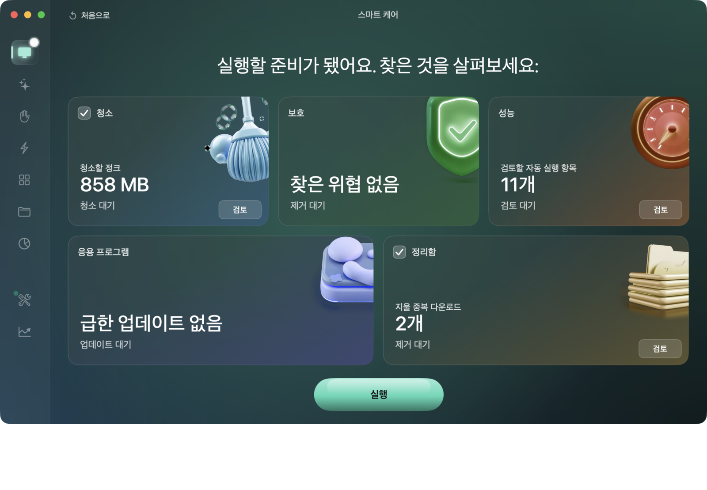
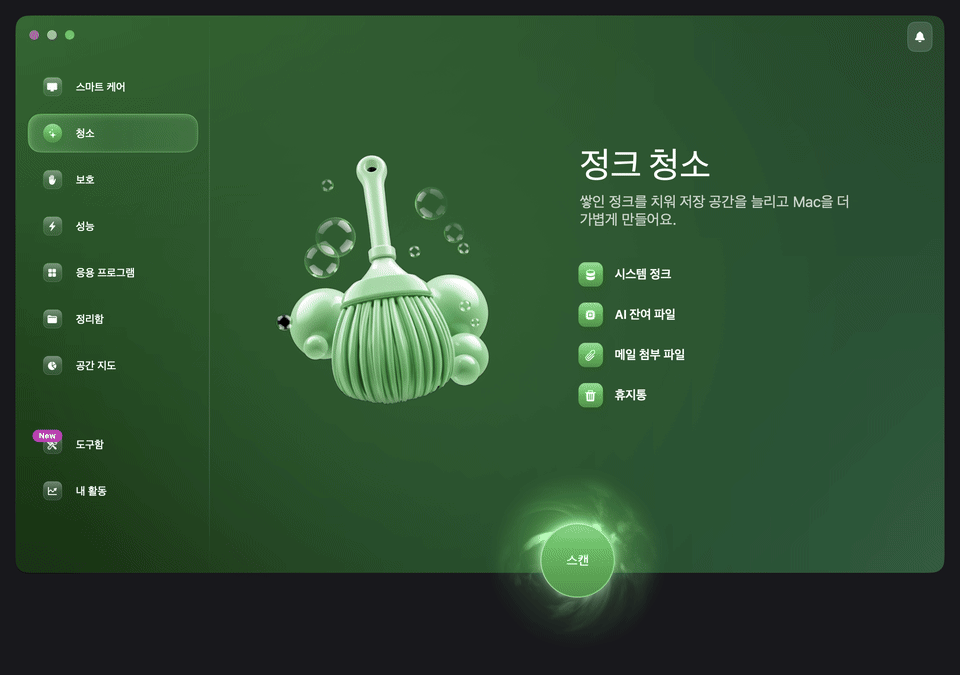
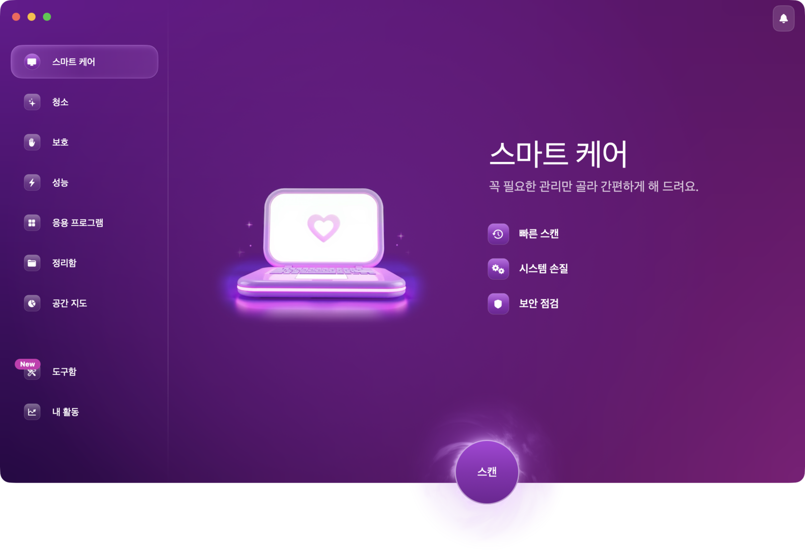
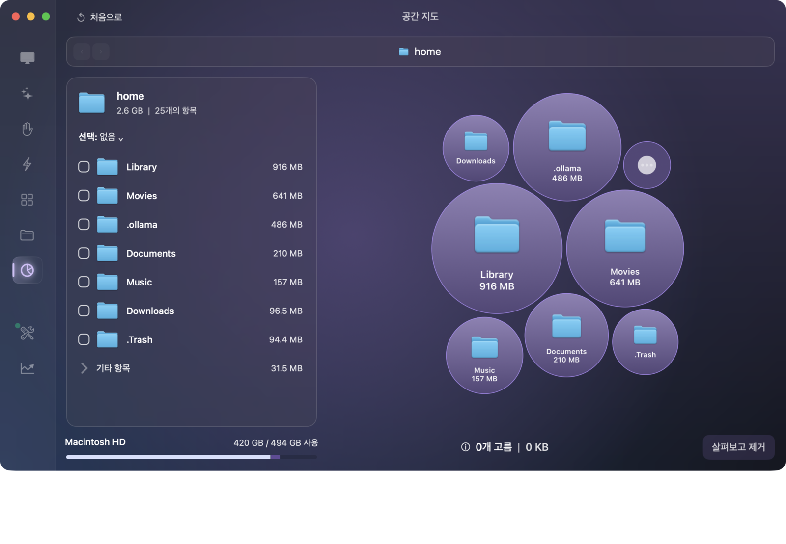

<p align="center">
  
</p>

<h1 align="center">말끔 (Malkkeum)</h1>

<p align="center">
  Mac에 쌓인 쓸모없는 파일을 찾아 정리하는 앱
</p>

<p align="center">
  <a href="https://github.com/gkgk545/WashMyMac_homebrew/releases/latest"></a>
  
  
</p>

<p align="center">
  
</p>

> [!IMPORTANT]
> **정크**(앱이 다시 만드는 캐시·로그 등)는 휴지통을 거치지 않고 **바로 지워** 곧장 공간이 생겨요. 되돌릴 수 없어요.
> 앱 제거·정리함 같은 **내 파일**은 휴지통으로 옮겨서, 휴지통을 비우기 전까지 되돌릴 수 있어요.
> 무엇이 어떻게 정리되는지는 [정리하면 무엇이 지워지나요?](#자주-묻는-것)에 모아 두었어요.

**바로 가기** · [설치](#설치) · [처음 열면](#처음-열면) · [이렇게 써요](#이렇게-써요) · [되돌리기](#잘못-정리했을-때) · [업데이트](#업데이트) · [베타에서 넘어왔다면](#베타에서-넘어왔다면) · [의견 보내기](#오류-보고와-의견) · [지우기](#지우기) · [자주 묻는 것](#자주-묻는-것)

## 설치

필요한 것: **Apple 칩(M1 이상) Mac**, **macOS 14 소노마 이상**

### 방법 1 · Homebrew (추천)

터미널을 열고 아래 두 줄을 차례로 붙여 넣으세요.

```bash
brew tap gkgk545/washmymac https://github.com/gkgk545/WashMyMac_homebrew
brew install --cask gkgk545/washmymac/malkkeum
```

- 응용 프로그램 폴더에 말끔(Malkkeum)이 생기고, 처음 열 때 **"열 수 없음" 창 없이 바로 열려요.**
  말끔은 Apple 공증을 받지 않아서, 설치 명령이 이 앱에 붙은 다운로드 확인 표시를 지워 줘요.
- 둘째 줄처럼 `gkgk545/washmymac/malkkeum` 전체 이름으로 설치해야 Homebrew가 이 저장소를 믿고 설치해요.
- Homebrew가 없다면 [brew.sh](https://brew.sh)의 설치 명령을 먼저 실행하세요.

### 방법 2 · 직접 내려받기

1. [최신 버전](https://github.com/gkgk545/WashMyMac_homebrew/releases/latest) 페이지에서 `Malkkeum-….zip`을 내려받아 두 번 눌러 풀어요.
2. 나온 `Malkkeum`(한국어 Mac에서는 "말끔")을 **응용 프로그램** 폴더로 끌어 놓아요.
   다른 곳에서 열면 앱이 "응용 프로그램 폴더로 옮길까요?"라고 물어요. **옮기기**를 누르세요(그래야 업데이트를 받아요).
3. 두 번 눌러 열면 처음 한 번은 **"열 수 없음"** 창이 떠요. **완료**를 누르세요.
4. **시스템 설정 › 개인정보 보호 및 보안**을 열고 맨 아래 "말끔" 옆의 **확인 없이 열기**를 누르세요.
   Mac 암호를 물으면 넣어요. 이 과정은 처음 한 번뿐이에요.

## 처음 열면

- 짧은 소개가 지나간 뒤 **전체 디스크 접근**을 허용해 달라고 해요. 안내 단추를 누르면 시스템 설정이 열리고,
  목록에서 말끔을 켜면 돼요. 허용하지 않아도 쓸 수는 있지만 찾는 것이 줄어요.
- 오류 보고를 자동으로 보낸다는 안내가 한 번 떠요. 원하지 않으면 끌 수 있어요([오류 보고와 의견](#오류-보고와-의견)).

## 이렇게 써요

<p align="center">
  
  <br><sub>청소: <b>스캔</b> → 결과 확인 → <b>청소</b> → 끝. 실제 속도 그대로예요.</sub>
</p>

1. 왼쪽에서 메뉴를 고르고 아래 둥근 **스캔** 단추를 눌러요.
2. 결과 카드의 **검토**를 눌러 무엇을 정리할지 꼭 확인하세요. 모르는 항목은 체크를 풀어 두면 돼요.
3. **청소**(스마트 케어는 **실행**)를 누르면 끝이에요.

| 메뉴 | 하는 일 |
|---|---|
| **스마트 케어** | 한 번의 스캔으로 정크·보안·속도·앱 업데이트·정리함을 한꺼번에 점검해요 |
| **청소** | 캐시·로그·Xcode 찌꺼기·AI 도구가 남긴 파일·휴지통 같은 정크를 찾아요 |
| **보호** | 의심스러운 파일과 앱을 검사해요 |
| **성능** | 로그인 항목·백그라운드 항목을 정리하고 유지 관리 작업을 돌려요 |
| **응용 프로그램** | 앱을 남은 파일까지 지우고, 업데이트가 있는 앱을 알려 줘요 |
| **정리함** | 큰 파일·오래된 파일·중복 파일·비슷한 사진을 모아 보여 줘요 |
| **공간 지도** | 어느 폴더가 공간을 차지하는지 거품 지도로 보여 줘요 |
| **메뉴 막대 아이콘** | 저장 공간·메모리·배터리를 한눈에 보여 줘요 |

<table>
  <tr>
    <td width="50%"></td>
    <td width="50%"></td>
  </tr>
  <tr>
    <td align="center"><sub>스마트 케어 — 처음은 여기서 <b>스캔</b>만 눌러 보세요</sub></td>
    <td align="center"><sub>공간 지도 — 거품이 클수록 공간을 많이 차지해요</sub></td>
  </tr>
</table>

## 잘못 정리했을 때

휴지통으로 옮긴 내 파일(앱 제거·정리함·공간 지도에서 지운 것)은 셋 중 아무거나로 되돌려요. 휴지통을 비우기 전까지는 언제든 돌아와요.
바로 지운 정크와 되돌릴 수 없는 변경(아래 [자주 묻는 것](#자주-묻는-것))은 되돌릴 수 없어요.

- 정리가 끝난 화면의 **휴지통에서 되돌리기**
- 위쪽 메뉴 **편집 › 마지막 정리 되돌리기**
- Finder에서 **휴지통**을 열고 항목을 오른쪽 클릭 › **되돌려 놓기**

시스템 폴더(`/Library/LaunchDaemons` 등)에서 휴지통으로 간 앱 파일은 원래 자리에 관리자 권한이 필요해서 말끔의 되돌리기가 건드리지 않아요.
Finder 휴지통에서 원래 자리로 끌어다 놓으세요(관리자 암호를 물어요). 원래 자리는 정리 기록(끝 화면의 **기록 보기**)에 있어요.

> [!TIP]
> 휴지통으로 옮긴 내 파일은 휴지통을 비워야 실제로 공간이 생겨요. 며칠 써 보고 괜찮으면 비우는 것을 권해요.

## 업데이트

새 버전은 앱이 알아서 챙겨요. Homebrew로 설치했어도 똑같아요(`brew upgrade`는 필요 없어요).

- **알림으로 받기**: 앱이 하루에 한 번 새 버전을 확인하고, 있으면 창으로 알려 줘요. **업데이트 설치**를 누르면 내려받아 다시 열어요.
- **직접 확인**: 위쪽 메뉴 **말끔 › 업데이트 확인…**
- **알아서 설치**: **말끔 › 설정 › 일반 › 업데이트**에서 "새 버전을 알아서 내려받고, 앱을 끝낼 때 설치"를 켜면 묻지 않고 설치해요.
  같은 곳에서 지금 버전도 볼 수 있어요. 문제를 알려 줄 때 함께 적어 주세요.

<p align="center">
   일반 화면: 업데이트 칸에 지금 버전, 지금 확인 단추, 자동 확인과 자동 설치 체크 상자">
</p>

## 베타에서 넘어왔다면

베타(0.x)를 쓰던 Mac은 평소처럼 업데이트를 받으면 1.0이 되고, 설정·기록·헬퍼·전체 디스크 접근은 그대로예요. **정리 방식이 바뀌어요.**

- **정크는 바로 지워요.** 베타에서는 휴지통으로 옮겼지만, 1.0부터는 휴지통을 거치지 않아 되돌릴 수 없어요. 브라우저 캐시도 마찬가지예요.
- **베타에서 건너뛰던 일을 해요.** 브라우저 기록 지우기, 최근 항목 목록 비우기, 문서의 이전 버전 지우기, Time Machine 로컬 스냅샷 줄이기처럼
  되돌릴 수 없는 일도 이제 실행해요. 청소의 **휴지통 비우기**는 청소 화면에서 직접 골랐을 때만 해요(스마트 케어는 휴지통을 건드리지 않아요).
  시스템 폴더에 남은 앱 파일(시작 항목·플러그인 등)은 관리자 권한으로 휴지통에 옮겨요.
  끝 화면의 "베타에서 정리하지 않음"은 더 나오지 않아요. 원하지 않는 항목은 검토 화면에서 체크를 풀어 두세요.
- **내 파일은 그대로 휴지통으로 가요.** 앱 제거·정리함·공간 지도에서 지운 것은 지금처럼 되돌릴 수 있어요.
- 베타 안내와 첫 정리 직전 확인 창은 더 뜨지 않아요. 예외 목록·보호 폴더는 베타 때와 똑같이 지켜요.
- 정리할 때 실행 중인 앱·AI 도구의 파일은 건너뛰어요(끝 화면에 "실행 중이라 건너뜀").
- 오류 보고는 베타에서 정해 둔 대로예요(끄지 않았다면 계속 보내요).

## 오류 보고와 의견

- **오류 보고**: 앱에 문제가 생기면 자동으로 보내요(처음 열 때 한 번 알려 드려요). 보내기 전에 사용자 이름·컴퓨터 이름·홈 폴더 경로·파일 이름은 지워요.
  원하지 않으면 **말끔 › 설정 › 일반**에서 "오류 보고 보내기"를 끄세요.
- 이상한 점이 있으면 **도움말 › 문제 보내기…** 메뉴로 알려 주세요(오류 보고를 켜야 보낼 수 있어요). 글은 비워 둬도 되고, 최근 정리 기록 몇 줄이 이름·경로를 지운 채 함께 가요.

## 지우기

- **Homebrew로 설치했다면**

  ```bash
  brew uninstall --cask malkkeum
  ```

  설정과 기록까지 지우려면 `brew uninstall --zap --cask malkkeum`.
- **직접 설치했다면**: 먼저 말끔의 설정 › 일반에서 **메뉴 막대에 보이기**를 끄고, 응용 프로그램 폴더의 `Malkkeum`(말끔)을 휴지통으로 옮겨요.
  메뉴 막대 아이콘은 몇 초 안에 저절로 사라져요. 지운 뒤에도 **시스템 설정 › 일반 › 로그인 항목 및 확장 프로그램 › 백그라운드 앱 활동**에
  말끔이 남을 수 있어요. 켜져 있으면 거기서 끄면 돼요.

## 자주 묻는 것

<details>
<summary><b>"열 수 없음" 창이 떠요</b></summary>

직접 내려받아 설치하면 처음 한 번 떠요. 말끔은 Apple 공증을 받지 않은 앱이라서예요.
**완료**를 누른 뒤 **시스템 설정 › 개인정보 보호 및 보안** 맨 아래에서 **확인 없이 열기**를 누르세요.
Homebrew로 설치하면 이 창이 뜨지 않아요.
</details>

<details>
<summary><b>"응용 프로그램 폴더로 옮길까요?"라고 물어요</b></summary>

다운로드 폴더 같은 곳에서 열었을 때 물어요. 응용 프로그램 폴더 밖에서는 업데이트를 받을 수 없어서예요. **옮기기**를 누르면 옮긴 뒤 다시 열어요.
</details>

<details>
<summary><b>전체 디스크 접근을 꼭 허용해야 하나요?</b></summary>

아니요. 허용하지 않으면 다른 앱의 캐시·메일 첨부 파일처럼 macOS가 막아 둔 곳을 보지 못해 찾는 양이 줄어요.
나중에 **말끔 › 설정 › 일반**의 **켜기**로 허용할 수 있어요.
</details>

<details>
<summary><b>정리하면 무엇이 지워지나요?</b></summary>

| 무엇 | 어떻게 | 되돌리기 |
|---|---|---|
| 청소(정크): 캐시·로그·Xcode 찌꺼기·AI 도구 임시 파일 등 | 바로 지움 | 안 됨 |
| 청소의 휴지통 비우기(직접 고를 때만) | 바로 지움 | 안 됨 |
| 앱 제거·정리함·공간 지도에서 고른 내 파일 | 휴지통으로 | 휴지통에서 |
| 정리함의 비슷한 사진 | 사진 앱 "최근 삭제됨"으로 | 사진 앱에서 |
| 시스템 폴더의 앱 찌꺼기(관리자 권한, 시작 항목·플러그인 등) | 휴지통으로 | Finder 휴지통에서 원래 자리로 끌어다 놓기(관리자 암호) |
| 브라우저 기록·캐시, 문서의 이전 버전, 최근 항목 목록 | 지움·비움 | 안 됨 |
| Time Machine 로컬 스냅샷 줄이기·제거 가능 공간 비우기 | 실행 | 안 됨 |
| 로그인 항목·권한 끄기 | 끔 | 설정에서 다시 켬 |

예외 목록에 넣은 것과 macOS가 보호하는 폴더는 정리하지 않아요. 검토 화면에서 체크를 푼 항목도 그대로 둬요.
**정리할 때 실행 중인 앱**(AI 도구 포함)의 파일은 골랐어도 건너뛰고, 끝 화면에 "실행 중이라 건너뜀"으로 알려 줘요. 그 앱을 끈 뒤 다시 정리하면 돼요.
</details>
